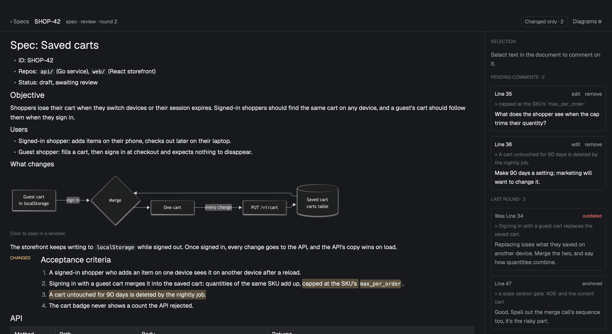
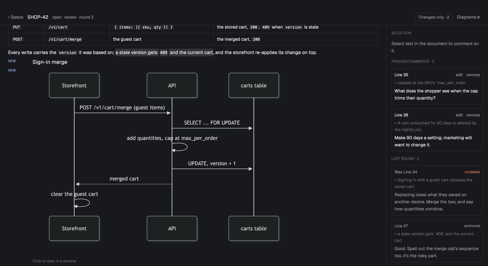
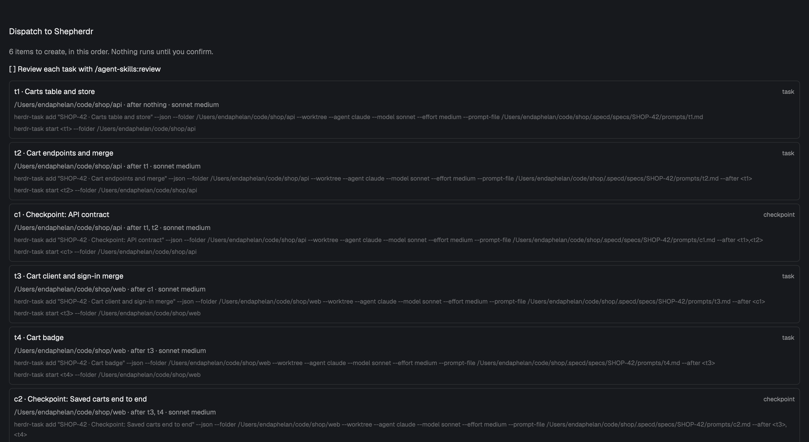

# specd

A [Herdr](https://herdr.dev) mod for spec-driven development. Review an agent's spec and plan
like a pull request (rendered markdown, mermaid diagrams, inline comments), then dispatch the plan's
tasks to [Shepherdr](https://herdr.dev) workers in git worktrees.



## What it does

- **Spec units.** A spec has an ID (a Jira key such as `PROJ-123`, or a slug). Files live in
  `specs/<ID>/spec.md`, `plan.md`, `tasks.json`; specd's own state is in `.specd/specs/<ID>/`.
- **Review like a PR.** Select text, comment, build a pending review, then **Submit** it as one
  message to the agent that owns the file. Every round is kept: the next round marks `NEW` and
  `CHANGED` sections and shows whether last round's comments are anchored, moved or outdated.
- **Diagrams.** Mermaid fences render as pictures (click one to open it full size).
- **Phases and dispatch.** Approving the spec starts the plan agent; approving the plan validates
  `tasks.json` and shows every `herdr-task` command before anything runs. **Confirm** creates the
  Shepherdr tasks in dependency order, one worktree per task, across repos.
- **Found specs.** Specs written by hand (`SPEC.md`, `SPEC-<id>.md`, `docs/SPEC.md`,
  `spec/<id>.md`, `specs/<id>/spec.md`) show under "Found" for one-click adoption.

Round 2 of a review: new and changed sections are marked, last round's comments re-anchored.



Approving a plan: the exact commands, in order, before anything is created.



## Install

Ask your Herdr agent: *"add the mod at github.com/craicoverflow/herdr-specd"*. It reads
[RECIPE.md](RECIPE.md) and the files, copies `mods/specd/` into `~/.config/herdr-app/mods/`, and
checks it.

Or by hand:

```sh
git clone https://github.com/craicoverflow/herdr-specd
cp -R herdr-specd/mods/specd ~/.config/herdr-app/mods/
herdr-app check ~/.config/herdr-app/mods/specd
```

Herdr picks it up within a second. Open the command palette (`⌘⇧P`): **specd: Open**,
**specd: New spec**, **specd: Adopt spec**. The folder is the focused terminal's working directory.

To update: `git pull`, then copy `mods/specd` again.

**What it runs and reads.** specd runs `herdr-task` (Shepherdr), `hc` (to message agents) and
`mmdc`; it reads and writes `specs/` and `.specd/` in the folder you open it in, and reads Claude
Code's session transcript (read only) to see whether the plan agent is in auto mode. It makes no
network requests of its own.

### Requirements

- Herdr with Shepherdr (`herdr-task` on `PATH`). Written against Shepherdr 3.1.3.
- [agent-skills](https://github.com/addyosmani/agent-skills) for Claude Code (checked with 0.6.18),
  for the default adapter.
- `mmdc` (mermaid-cli) for diagrams. Optional: without it diagrams show as source.

### mmdc setup

Skip the ~150 MB Chromium download and use the Chrome you already have:

```sh
PUPPETEER_SKIP_DOWNLOAD=1 npm install -g @mermaid-js/mermaid-cli
echo '{ "executablePath": "/Applications/Google Chrome.app/Contents/MacOS/Google Chrome", "headless": "shell" }' > ~/.mmdc-puppeteer.json
```

In the pane header's **Diagrams** settings, set **puppeteer config** to `~/.mmdc-puppeteer.json`
(and **mmdc path** if it isn't on `PATH`). Tested with `@mermaid-js/mermaid-cli` 12.2.0.

## Try it on the example

[`examples/checkout`](examples/checkout) is a two-repo folder (`api/`, `web/`) with one spec,
`SHOP-42` (saved carts): a spec with two mermaid diagrams, a plan, and a `tasks.json` with
tasks and checkpoints across both repos.

```sh
cp -R herdr-specd/examples/checkout ~/checkout-demo && cd ~/checkout-demo
for r in api web; do mkdir -p $r && git -C $r init -q && git -C $r commit -q --allow-empty -m init; done
```

Open **specd: Open** from a terminal in `~/checkout-demo`: `SHOP-42` shows under Found. Click
**Adopt**, comment on a few lines, and **Approve plan** to see the dispatch preview (nothing is
created until you click **Confirm**).

## Adapters

One JSON file per spec framework, in `mods/specd/adapters/`: which paths, agent argv and prompt each
phase uses. `agent-skills.json` is the only one shipped; add another JSON file next to it.

## Develop

```sh
npm test          # node --test, no Herdr needed
npm run check     # herdr-app check mods/specd
npm run link      # copy mods/specd into ~/.config/herdr-app/mods/specd
```

Mod rule: never start async work from `render()`. The design is in
[specs/specd-mvp/spec.md](specs/specd-mvp/spec.md) (specd was built with its own workflow) and
[test/e2e.md](test/e2e.md) records what was checked by hand.

## Not done yet

Jira integration, a second shipped adapter, multi-machine.

## License

[MIT](LICENSE).
