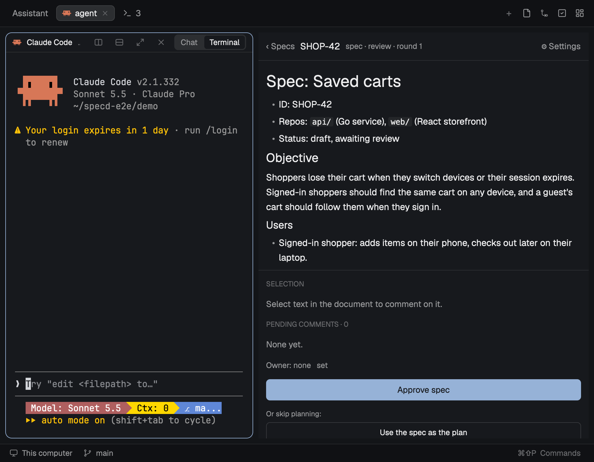
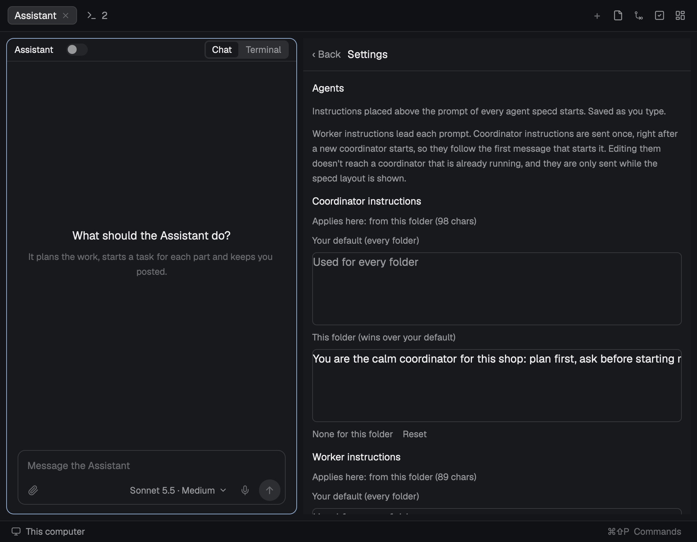

# specd

A [Herdr](https://herdr.dev) mod for spec-driven development, and a layout that puts it beside your
agent. Review an agent's spec and plan like a pull request (rendered markdown, mermaid diagrams,
inline comments), then dispatch the plan's tasks to [Shepherdr](https://herdr.dev) workers in git
worktrees.

- **specd** is the mod: a spec list, a review view, a dispatch preview.
- **The `specd` layout** is Shepherdr's task layout with specd in the right panel in place of
  Artifacts, and agents opening in Terminal instead of Chat.


## Quick start

```sh
git clone https://github.com/craicoverflow/herdr-specd && cd herdr-specd
sh scripts/link.sh                                     # install the mod and the layout
herdr-app do layout.switch '{"name":"specd"}'          # switch to the specd layout
```

Then pick specd from the panel icons at the top right and click **New spec…** or **Adopt spec…**.
Step by step, with what you should see: [Install guide](docs/guides/install.md).

## The main flows

**The specd panel.** Your specs, their phase, pending comments and task counts. **Found** lists
specs written by hand, for one-click adoption.


**Review round.** Select text, comment, build a pending review, **Submit** it as one message to the
agent that owns the file. The panel folds to one column when narrow. Guide: [Review a
spec](docs/guides/review.md).



**Dispatch preview.** Approving the plan shows every `herdr-task` command, and the worker
instructions that lead each prompt, before anything runs. **Confirm** creates the tasks. Guide:
[Dispatch the plan](docs/guides/dispatch.md).


**Agents settings.** Instructions for the workers and coordinators specd starts: your default, or an
override per folder. Guide: [Agent instructions](docs/guides/agents.md).



**Terminal header.** In the layout, agents open in Terminal, with Chat one click away.


## What it does

- **Spec units.** A spec has an ID (a Jira key such as `PROJ-123`, a slug, or `003-name`). New
  specs live in `specs/<ID>/spec.md`, `plan.md`, `todo.md`; adopted ones stay where they are, in
  whatever format they have. specd's own state is in `.specd/specs/<ID>/`.
- **Review like a PR.** Every round is kept: the next round marks `NEW` and `CHANGED` sections and
  shows whether last round's comments are anchored, moved or outdated.

  
- **Diagrams.** Mermaid fences render as pictures (click one to open it full size).
- **Phases and dispatch.** Approving the spec starts the plan agent with its native command
  (`/agent-skills:plan`), told only where to save. Approving the plan works out the task list from
  the spec, plan and task list, whatever their format (one model call, cached until a file changes),
  and shows every `herdr-task` command before anything runs. **Confirm** creates the Shepherdr tasks
  in dependency order, one worktree per task, across repos. A spec that is already a plan (an RFC, a
  plan-mode document) or a small ticket can skip the plan phase.
- **Found specs.** Specs written by hand (`SPEC.md`, `SPEC-<id>.md`, `docs/SPEC.md`,
  `spec/<id>.md`, `specs/<id>/spec.md`, `rfcs/<id>.md`, ticket files such as `PROJ-123.md`) show
  under "Found" for one-click adoption.

The round-2 picture was taken when specd still opened as a tab; the review works the same in the panel.

Outside the `specd` layout specd still works: it opens as a tab. Palette (`⌘⇧P`): **specd: Open**,
**specd: New spec**, **specd: Adopt spec**. The folder is the focused terminal's working directory.

## Requirements

- Herdr with Shepherdr (`herdr-task` on `PATH`). Written against Shepherdr 3.1.3.
- [agent-skills](https://github.com/addyosmani/agent-skills) for Claude Code (checked with 0.6.18),
  for the default adapter.
- `mmdc` (mermaid-cli) for diagrams. Optional: without it diagrams show as source. Setup (reusing
  your Chrome, no 150 MB download) is in [Troubleshooting](docs/guides/troubleshooting.md#diagrams-show-as-source-mmdc-missing).

## What it runs and reads

specd runs `herdr-task` (Shepherdr), `hc` (to message agents) and `mmdc`; it reads and writes
`specs/` and `.specd/` in the folder you open it in, and reads Claude Code's session transcript
(read only) to see whether the plan agent is in auto mode. It makes no network requests of its own.
Installing copies files into `~/.config/herdr-app/` (`layouts/specd.*`, `mods/specd`) and nothing
else; `sh scripts/link.sh --remove` takes them out again.

## Guides

- [Install, switch layout, switch back, uninstall](docs/guides/install.md)
- [Review a spec](docs/guides/review.md)
- [Dispatch the plan](docs/guides/dispatch.md)
- [Agent instructions](docs/guides/agents.md)
- [Troubleshooting](docs/guides/troubleshooting.md): `mmdc` missing, `herdr-task` missing, layout
  not listed, specd opens as a tab, panel too narrow, instructions not applied

## Try it on the example

[`examples/checkout`](examples/checkout) is a two-repo folder (`api/`, `web/`) with one spec,
`SHOP-42` (saved carts): a spec with two mermaid diagrams, a plan, and a `tasks.json` (the format
older specd versions wrote, still read as it is) with tasks and checkpoints across both repos.

```sh
cp -R herdr-specd/examples/checkout ~/checkout-demo && cd ~/checkout-demo
for r in api web; do mkdir -p $r && git -C $r init -q && git -C $r commit -q --allow-empty -m init; done
```

Open a terminal tab in `~/checkout-demo` (specd uses the focused terminal's folder), then run
**specd: Open**: `SHOP-42` shows under Found. Click
**Adopt**, comment on a few lines, and **Approve plan** to see the dispatch preview (nothing is
created until you click **Confirm**).

## Adapters

One JSON file per spec framework, in `mods/specd/adapters/`: which paths, agent argv and prompt each
phase uses. `agent-skills.json` is the only one shipped; add another JSON file next to it.

## Develop

```sh
npm test          # node --test, no Herdr needed
npm run check     # herdr-app check mods/specd
npm run link      # copy layouts/ and mods/ into ~/.config/herdr-app
```

Mod rule: never start async work from `render()`. The design is in
[specs/specd-mvp/spec.md](specs/specd-mvp/spec.md) (specd was built with its own workflow);
[test/e2e.md](test/e2e.md) records what was checked by hand.

## Not done yet

Jira integration, a second shipped adapter, multi-machine.

## License

[MIT](LICENSE).
