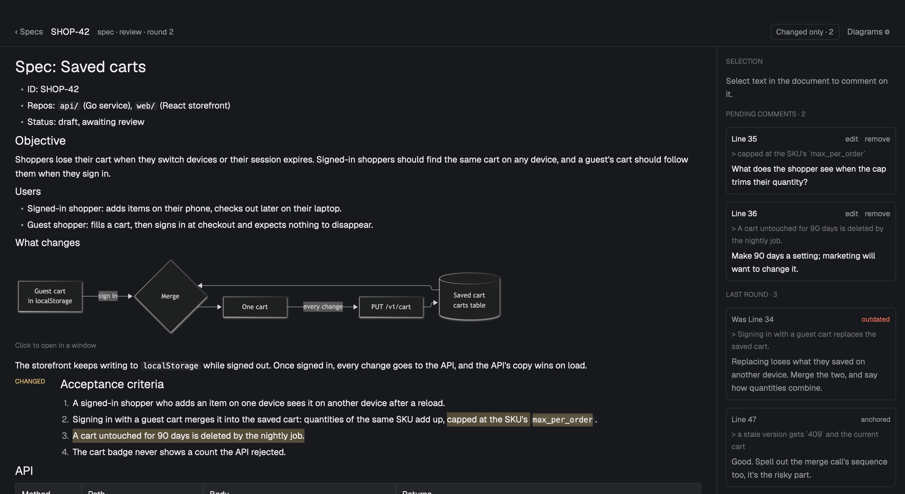

# specd

A tab in Herdr for reviewing an agent's spec and plan like a pull request, then handing the plan's
tasks to Shepherdr. You see a spec rendered as a document, with mermaid diagrams drawn as pictures;
you select a passage, write a comment, and send all comments to the agent at once. When you approve
the plan, the tasks are created for Shepherdr workers.

## What you see

One mod pane (`place: none`, opened as a tab, focusable), full width, themed from Herdr's colors
(`theme()`), a header and a body.

- **Spec list** (nothing selected): title "Specs" with two outlined buttons, **New spec…** and
  **Adopt spec…**. A table: ID (90px), Title, Phase (70px), Pending (70px), Tasks (50px). Empty:
  "No specs in this folder yet." Below, a "Found" group of specs written outside specd, each with
  **Adopt** and **Dismiss**.
- **Review**: a header row (`‹ Specs`, the ID in semibold 14px, `<phase> · <status> · round <n>`,
  a "Changed only · n" toggle after round 1, a diagram settings popover). Below it, left: the
  document in a scrolling column (24px side padding, 14px text) split into pieces at every heading
  and around code and mermaid fences. Right: a 300px side panel on the surface color with a left
  border: **SELECTION**, **PENDING COMMENTS · n** (cards with `Lines a-b`, edit, remove, the
  quoted line and the comment), **LAST ROUND · n** (read-only cards tagged `anchored`, `moved?` or
  `outdated`), a **Submit n comments** button and an **Approve spec / Approve plan** button in the
  accent color (grey and disabled when not allowed, with the reason under it).
- **Margin marks** in rounds 2+: a 64px column with `NEW` (accent) or `CHANGED` (working color).
- **Dispatch preview** and **Build** views: rows by task with repo, dependencies, model and the
  exact `herdr-task add` argv; later, tasks grouped by repo with their Shepherdr state and `n/m done`.
- **Forms**: New spec (ID, brief, adapter, models, folder) and Adopt spec (spec, plan, tasks files, ID).

## How it behaves

- **Phases**: a spec is `spec → plan → build → done`; status `drafting`, `review`, `approved`.
  Drafting means an agent is writing; the document appearing moves it to review.
- **Comment**: selecting text in a piece shows its source lines (1-based, matching `sed -n`),
  the quote and an input; Enter adds. A selection with no source range says "Can't comment on this
  selection". A selection never crosses two pieces. Pending comments are highlighted in the text.
- **Submit** sends one numbered message (line numbers, `>`-quoted source, one closing instruction)
  to the owner agent with `hc send`; if the owner's terminal is gone it opens a new `<ID> <phase>`
  agent tab whose first message is the review. The round is saved and the status returns to drafting.
- **Approve** is disabled with pending comments. Approving a spec opens the `<ID> plan` agent;
  approving a plan validates `tasks.json` (cycles, unknown repos, bad ids: all errors listed,
  nothing created, **Send to plan agent** returns them), then shows a preview; **Confirm** runs
  `herdr-task add --json` per item in dependency order, then `herdr-task start`. A failure keeps the
  refs made; running again creates only the missing ones. Workers get `--permission-mode auto`
  only when the plan agent's session is in auto mode.
- **Diagrams**: rendering shows the source and a spinner, then a PNG; a failure or missing `mmdc`
  leaves the source with a note. Clicking a diagram opens it at natural size, scrollable. Switching
  Herdr's theme re-renders.
- **Found**: a new matching file appears under Found within 2 s with one toast; Dismiss persists.
- The folder is watched; the list and the open document reload on change. Build status polls every
  10 s only while the window is visible.

## Built from

- `mod.json`: `{"place":"none","title":"specd","focusable":true,"palette":[...]}` with three palette
  entries running `tab.new` for this mod (`specd: Open`, `specd: New spec` with `props.new`,
  `specd: Adopt spec` with `props.adopt`).
- `main.js` (one class: init, render, `command(c)` for `top open-first next back approve confirm new
  adopt`), `core/` (pure logic: state, comments, anchors, pieces, rounds, tasks validation, dispatch,
  adapters, found, summary), `io/` (files, agents, herdr-task, mermaid), `ui/` (list, document, side,
  diagram, new, adopt, dispatch, build), `adapters/agent-skills.json`.
- Modules: `herdr` (`props`, `spaces`, `focused`, `settings`, `exec`, file picking), `gpui-kit`
  (`div`), `gpui-base` (`v_flex`, `h_flex`, `Input`, `TextView`, `InputState`).
- Programs run: `herdr-task` (add, start, list), `hc` (send, read) via the agent helpers,
  `mmdc` (mermaid-cli 12.2.0: `-p <puppeteer.json> -q -i in -o out -s 2 -b transparent -t dark|default`).
- Files it reads or writes outside its folder: the chosen folder's `specs/`, `.specd/`, adapter paths,
  and Claude Code's session transcript (`~/.claude/projects/<slug>/<session>.jsonl`, read only,
  for the permission mode).
- State: `.specd/specs/<ID>/state.json` (`state:1`, id, adapter, brief, paths, models, phase,
  status, round, owners, pending, dispatch) and `.specd/specs/<ID>/rounds/<n>/`.
- No images or art.

## Watch out

- Never start async work from `render()`: `cx.notify()` during render throws and the task dies
  silently. Start work in `init`, timers or commands.
- A mod folder reached through a symlink isn't hot-reloaded: copy it, and every save of a mod file
  reloads every copy, so batch edits.
- mmdc SVGs use `foreignObject` and native renderers drop the labels: use PNG at `-s 2`; the
  default theme's dark lines vanish on dark, so the cache key is `hash(source)-theme`.
- `scroll_to_item` only scrolls whole children, which is why documents are split into pieces.
- Offsets are UTF-16; astral characters (`𝑓`) count as two. Anchor by quote, not only offset.
- `herdr-task add` never starts a task; `start` on an unfinished dependency queues it;
  `--after` must only get refs `add` returned.
- Comments can't span two sections or a diagram; no threads, no suggested changes.
- Needs `herdr-task` on `PATH` and agent-skills for the default adapter; assumes Opus plans and
  Sonnet builds, changeable in the New spec dialog.
- Not checked from the CLI: whether the name `specd` is free on herdr.dev/mods.

## Done when

- `npm test` passes and `herdr-app check` on the mod passes.
- New spec `DEMO-1` writes `specs/DEMO-1/spec.md` and opens a `DEMO-1 spec` agent tab.
- A selection in a paragraph, a table cell and two list items gives lines matching `sed -n`.
- Submit sends one message to the owner and saves round 1; round 2 marks edited sections.
- Approve is disabled with a pending comment.
- A `tasks.json` with a cycle and an unknown repo shows both errors and creates nothing; a valid one
  creates every task with the right `--folder`, `--after` and `--model`.
- Diagrams render in dark and light, and show as source when `mmdc` is missing.
- A hand-written `SPEC-auth.md` shows under Found within 2 s and Adopt gives it the ID `auth`.
