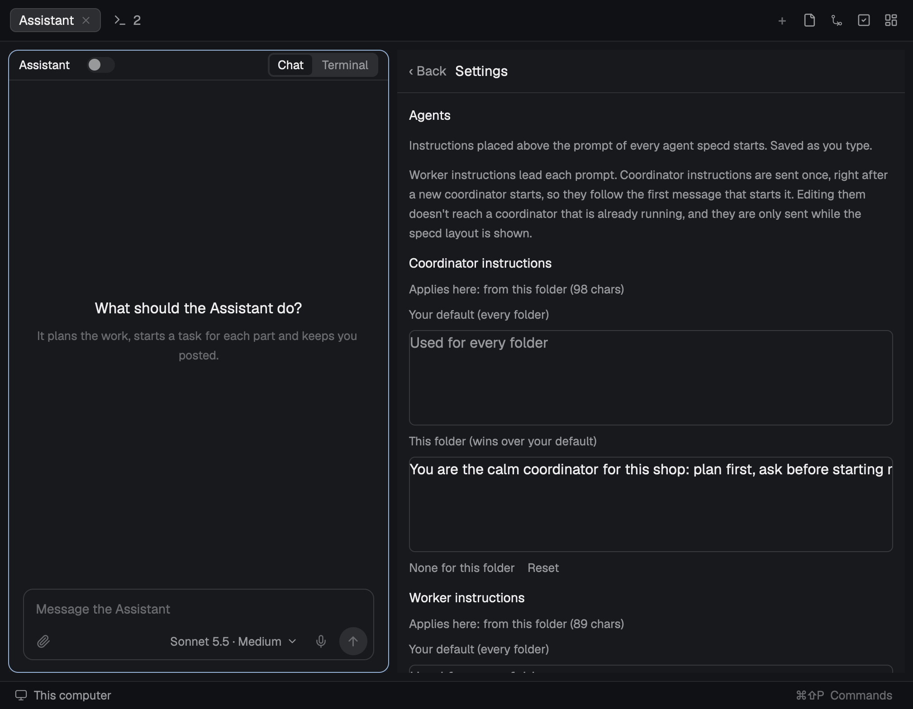

# Give your agents standing instructions

Set a persona and house rules once, and specd puts them in front of the agents it starts: **worker
instructions** lead every task's prompt, and **coordinator instructions** go to the space's
coordinator (Herdr's Assistant) when it starts. Empty means nothing changes.

> **Checked live vs. not yet.** ✔ = run in the live window ([test/e2e.md](../../test/e2e.md),
> "specd layout", L9 and L11). ○ = not run there; it comes from the code and its tests and is
> walked through in the docs run-through.

## 1. Open Settings ✔

In the specd panel, click **⚙ Settings** (top right of the spec list and of a spec's review).

You see **Settings** with a **‹ Back** link, and an **Agents** section. A short note explains when
each kind is used. Below it are two blocks, **Coordinator instructions** and **Worker
instructions**, then the **Diagrams** section.



## 2. Set your default ○

In a block, type in the box under **Your default (every folder)**. It saves as you type; the
default is yours, kept by specd, and applies to every folder that has no override.

## 3. Override it for one folder ✔

Type in the box under **This folder (wins over your default)**. It saves as you type, into the
folder's `.specd/config.json`:

```json
{ "instructions": { "worker": "…", "coordinator": "…" } }
```

The other keys in that file are kept. If the file isn't valid JSON, specd leaves it alone and
shows a **Not saved** message.

## 4. See which value applies ✔

Each block has an **Applies here** line:

- `from this folder (89 chars)`: the folder's override is used;
- `your default (N chars)`: no override, so your default is used;
- `none`: neither is set, so the agents start as before.

The same line for workers appears above the items in the [dispatch preview](dispatch.md).

## 5. Turn instructions off for one folder ○

Under the folder box, click **None for this folder**. That sets the folder's value to empty, and an
empty folder value *wins*: this folder gets no instructions even if you have a default. The
**Applies here** line then reads `none`.

Click **Reset** to remove the folder's key instead, so the folder follows your default again.

## 6. What a running coordinator does

Coordinator instructions are sent once, right after a *new* coordinator starts, so they arrive after
the first message that starts it.

- Editing them doesn't reach a coordinator that is already running. Start a new one (a new space's
  Assistant) to use the new text.
- They are only sent while the `specd` layout is shown.
- Each coordinator is told once; restarting it tells it again.

Worker instructions have no such wait: the next dispatch uses whatever applies at that moment.

## Check it worked

- **Workers:** open the dispatch preview ([dispatch.md](dispatch.md)); the instructions line shows
  where they come from ✔. After **Confirm**, a worker's first prompt starts with them ○.
- **Coordinator:** start a new coordinator and look at its first messages ○.
