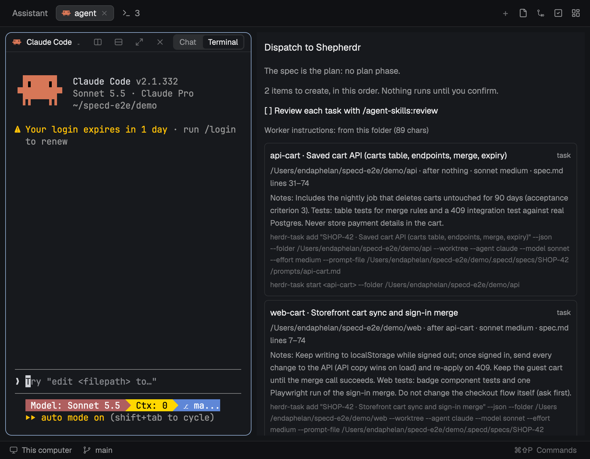
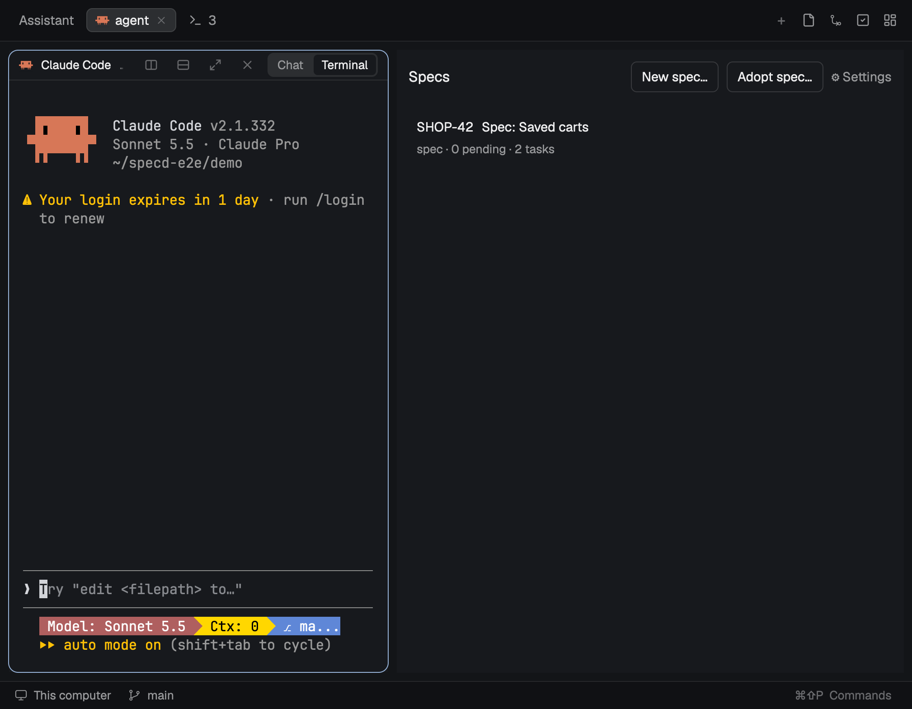

# Dispatch a plan to Shepherdr

Turn an approved plan into Shepherdr tasks: one worktree and one worker per task, in dependency
order. You see every command before anything runs. Start from a spec in the plan phase (see
[review.md](review.md)).

> **Checked live vs. not yet.** ✔ = run in the live window ([test/e2e.md](../../test/e2e.md),
> "specd layout"). ○ = not run there, because **Confirm** would create real tasks; its expected
> results come from the code and its tests and are walked through in the docs run-through.

## 1. Approve the plan ✔

Open the spec in the specd panel. When the plan agent has saved the plan and it is in review, read
it and comment as for a spec ([review.md](review.md), steps 4 to 6). Then click **Approve plan**.
(For a spec that skips planning, click **Use the spec as the plan** or **Dispatch as one task**
instead; the preview opens the same way.)

The panel changes to **Dispatch to Shepherdr**. While specd works out the task list from the spec
and plan it says so ("Working out the tasks from the spec…, one model call, usually 10–20 s…").

## 2. Read the preview ✔

You see:

- a line saying how many items will be created, in order: `N items to create, in this order. Nothing
  runs until you confirm.`
- a checkbox, **Review each task with /agent-skills:review**, which asks every worker to review its
  own change before it says it is done;
- the **instructions line**, `Worker instructions: from this folder (89 chars)` (or `your default`,
  or `none`). It says whether worker instructions will lead every task's prompt and where they come
  from; set them in [agents.md](agents.md);
- one card per item: its ID and title, whether it is a `task` or a checkpoint, the folder it runs in,
  what it waits for (`after nothing`, `after api-cart`), its model and effort, the lines of the spec
  it covers, any notes, and the exact `herdr-task add` and `herdr-task start` commands.

Narrow panels wrap the long commands rather than cut them off.

Not the split you want? Type what to change under **Not the split you want? Say what to change and
ask again.** and click **Ask again** ○.

## 3. Confirm ○

Click **Confirm**. specd creates the tasks in dependency order, each with its own worktree, and
starts the ones with nothing to wait for. Progress reads `N of M created, K started.` and at the end
`Dispatched: N tasks created, K started.` Click **Done**.

Each worker's prompt starts with your worker instructions (if any), then a rule, then the task. If
something fails part-way, the button becomes **Finish dispatch**; what was already created is kept.

**Cancel** closes the preview and creates nothing.

## 4. Follow the work on the Tasks board ✔ (board seen beside the agent; live task status ○)

Open **Tasks** in the right panel (its icon is in the panel's top bar, next to Files and Changes).
Shepherdr's board tracks each task: its status, files, changes and pull request. specd creates the
tasks; the board tracks them. A task's tab in the task tab bar shows its agent in Terminal, with the
Chat/Terminal switch one click away.

Back in specd, the spec's row in the list shows its task count. Come back to the spec's view to see
build status as the tasks finish.

## If something goes wrong

See [troubleshooting.md](troubleshooting.md).
