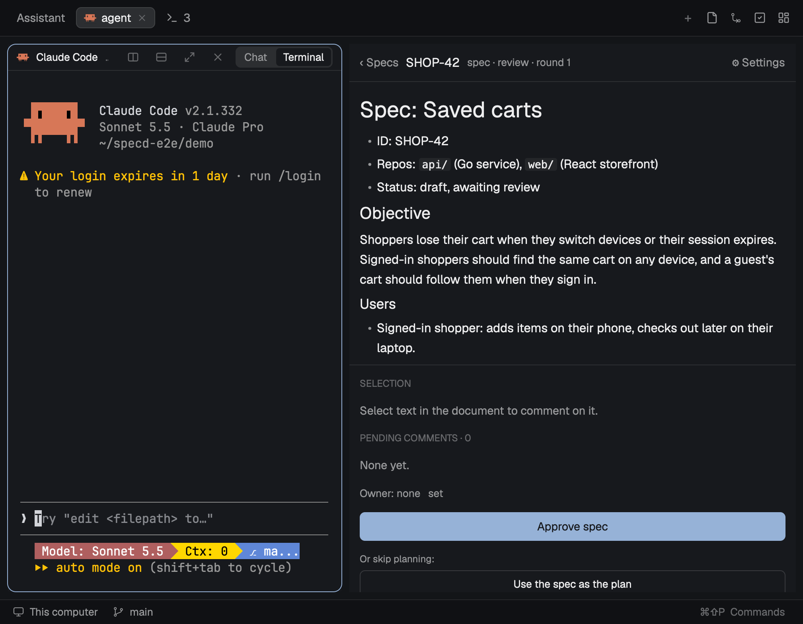
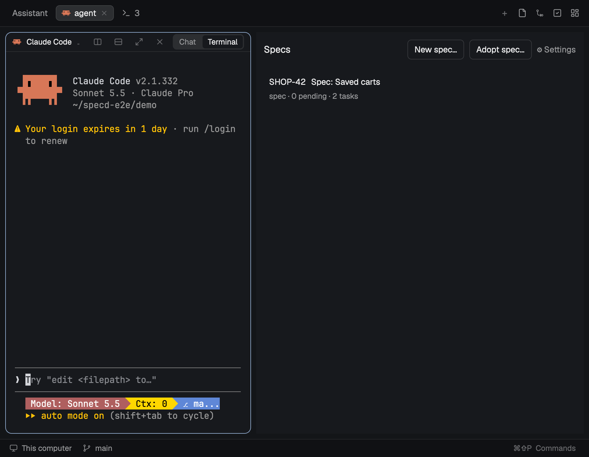

# Install specd and switch to the specd layout

By the end you have the `specd` mod and the `specd` layout installed, specd showing in the right
panel beside your agent, and you know how to go back or remove it.

You need Herdr with Shepherdr (`herdr-task` on `PATH`) and `git`. The full list is under
[Requirements](../../README.md#requirements).

## 1. Install

```sh
git clone https://github.com/craicoverflow/herdr-specd
cd herdr-specd
sh scripts/link.sh
```

**Expected:** one `copied …` line per layout file and per mod folder, then a note about symlinks:

```text
copied …/layouts/specd.json -> ~/.config/herdr-app/layouts/specd.json
copied …/layouts/specd.svg -> ~/.config/herdr-app/layouts/specd.svg
copied …/mods/specd -> ~/.config/herdr-app/mods/specd
note: not symlinked, because Herdr doesn't hot-reload a symlinked mod; re-run 'npm run link' after edits
```

The script copies only into `layouts/` and `mods/` of `~/.config/herdr-app` (or `$HERDR_APP_HOME`)
and never touches Herdr's own layouts, mods or templates.

Or ask your Herdr agent: *"add the mod at github.com/craicoverflow/herdr-specd"*; it follows
[RECIPE.md](../../RECIPE.md) and does the same.

Check the mod loaded:

```sh
herdr-app check ~/.config/herdr-app/mods/specd
```

**Expected:** `"errors": []` (or no errors listed). If not, see [Troubleshooting](troubleshooting.md).

## 2. Switch to the specd layout

```sh
herdr-app do layout.switch '{"name":"specd"}'
```

**Expected:** the window changes at once. Your agent is on the left, in the Terminal view, and the
right panel is a stack of panels. The panel opens on Tasks; pick the specd panel from the panel
icons at the top right (the last one). It shows the **Specs** list.



The list, with `New spec…`, `Adopt spec…` and a Settings link:



From now on the command palette (`⌘⇧P`) commands **specd: Open**, **specd: New spec** and
**specd: Adopt spec** focus this panel instead of opening a tab.

## 3. Check an agent opens in Terminal

Open a new agent tab (for example Claude Code).

**Expected:** its header shows the **Chat | Terminal** switch with **Terminal** selected and the CLI
running. Click **Chat** for the chat view, **Terminal** to come back.


## 4. Switch back

```sh
herdr-app do layout.switch '{"name":"shepherdr"}'
```

**Expected:** Shepherdr's own layout returns, with its Artifacts panel. Your specs and `.specd/`
files are untouched. Outside the `specd` layout, specd opens as a tab.

`layout.switch` with no name shows the next layout in turn.

## 5. Update

```sh
cd herdr-specd && git pull && sh scripts/link.sh
```

**Expected:** the same `copied …` lines. The mod reloads within a second.

## 6. Uninstall

```sh
sh scripts/link.sh --remove
```

**Expected:** a `removed …` line for each of `layouts/specd.json`, `layouts/specd.svg`,
`mods/specd` and `mods/pane-specd` that was there, and nothing else. Switch to another layout first
(step 4) if the `specd` layout is showing.

## Next

- [Review a spec](review.md)
- [Dispatch the plan](dispatch.md)
- [Agent instructions](agents.md)
- [Troubleshooting](troubleshooting.md)
