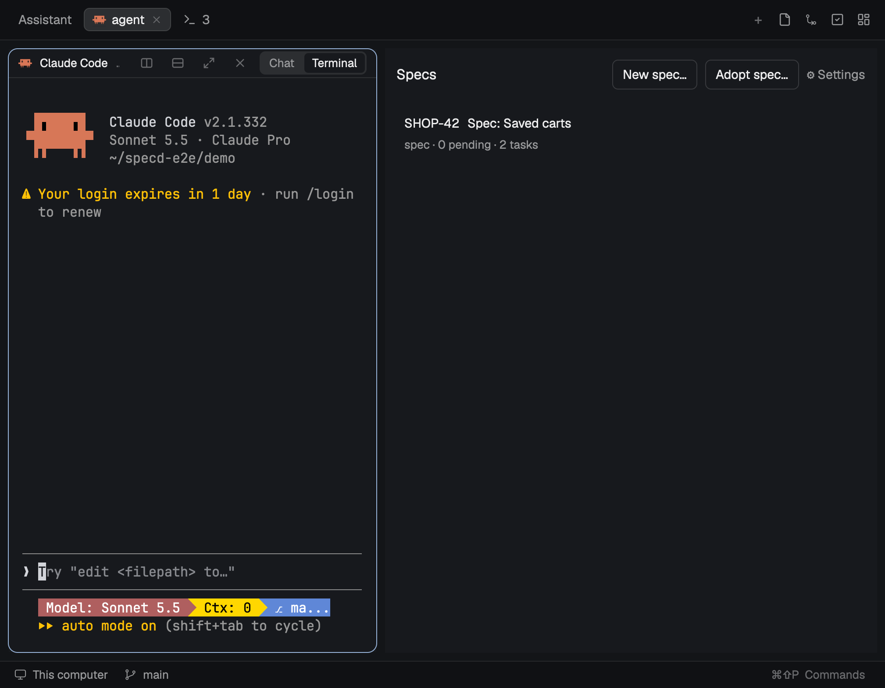
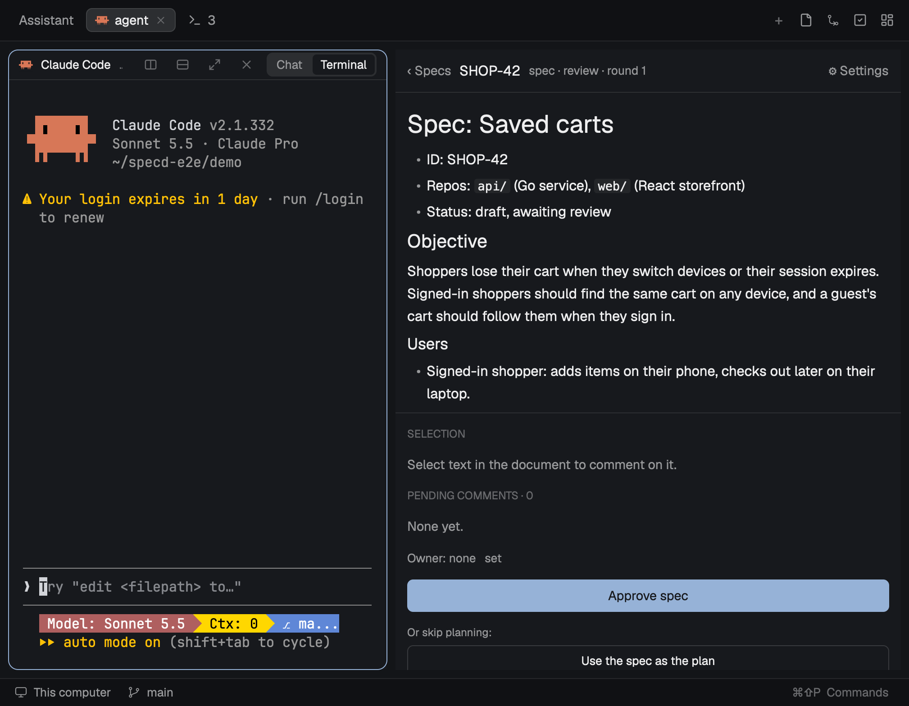
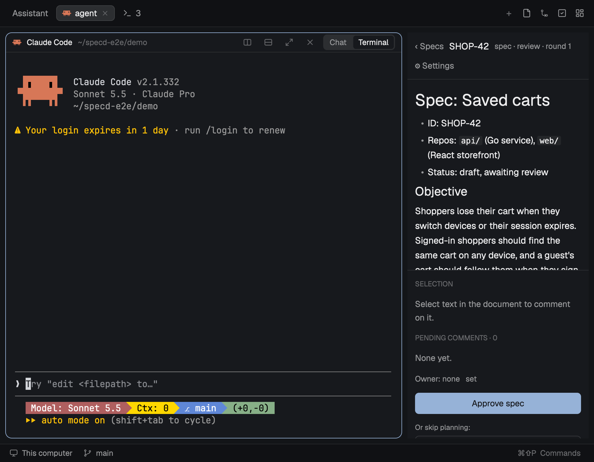
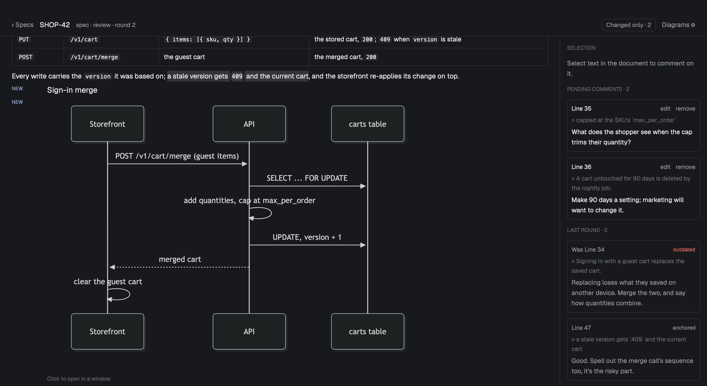

# Review a spec

Start a spec (or adopt one you already have), review it round by round like a pull request, and
approve it. Everything happens in the specd panel on the right of the `specd` layout, next to the
agent's terminal. Not in the layout yet? See [install.md](install.md).

**Before you start:** the `specd` layout is selected and a terminal in the folder you want to work in
is focused. The folder is that terminal's working directory.

> **Checked live vs. not yet.** Steps marked ✔ were run in the live window (see
> [test/e2e.md](../../test/e2e.md), "specd layout"). Steps marked ○ were not run there (they need a
> click, typing or a real agent) and are walked through for the first time in the docs run-through;
> what they say comes from the code and its tests.

## 1. Open specd ✔

Open the command palette (`⌘⇧P`) and run **specd: Open**.

You see the **Specs** list in the right panel, beside the agent's terminal. It shows each spec's ID,
title, phase, pending comments and tasks, and the **New spec…** and **Adopt spec…** buttons. If the
folder has no specs yet it says "No specs in this folder yet."

In any other layout, **specd: Open** opens specd as a tab instead.

## 2. Start a new spec, or adopt one

**New spec** ○: click **New spec…** (or run **specd: New spec**). Fill in the **ID** (a Jira key such
as `PROJ-123`, a slug, or `003-name`), **What to build**, and optionally **Model** and **Effort**,
then click **Start**. An agent starts in a new tab and writes `specs/<ID>/spec.md`. When the file
appears, the spec moves to review on its own.

**Adopt a spec you already have** ✔ (the list and review views; the adopt form itself ○): click
**Adopt spec…** (or run **specd: Adopt spec**), click **Choose…** for the spec file (the plan and task
list are optional) and click **Adopt**. The files stay where they are, in whatever format; specd only
records their paths. Specs it finds by name (`SPEC.md`, `rfcs/<id>.md`, …) are listed under **Found**
with **Adopt** and **Dismiss** buttons.

## 3. Open the spec to review it ✔

Click the spec's row in the list.

The panel shows the document, rendered. The header reads `‹ Specs`, the spec's ID, then
`spec · review · round 1`. Below the document is the comment column: **SELECTION**
("Select text in the document to comment on it."), **PENDING COMMENTS · 0** ("None yet."), the
**Owner** line, and the **Approve spec** button.

The panel's width is yours to set (drag its edge between 280 and 900px). Below about 640px the
comment column sits under the document; wider, it sits beside it. At 280px the document becomes a
short scroll region above the comment column:

## 4. Comment on it ○

Select text in the document. The comment column shows the line range and a quote of what you
selected, with a box. Type your comment and press **Enter** to add it. It appears under **PENDING
COMMENTS**, and the passage is highlighted in the document.

On a pending comment, click its line range to jump to it, **edit** to change it (**Enter** saves), or
**remove** to drop it.

## 5. Submit the review ○

Click **Submit N comments**. specd keeps the document as this round and sends all your comments as
one message to the agent that owns the file. If nothing owns it yet, it asks **Send this review to
which agent?** and lists your live agent terminals (or **Start a new agent**); pick one.

The pending list empties and the spec goes back to drafting while the agent revises.

## 6. Read the next round ✔

When the agent saves a revised file, the spec is back in review and the header says `round 2`.

- Sections that are new or changed are marked **NEW** or **CHANGED** beside them.
- **Changed only · N** (in the header) hides everything else.
- **Last round · N** lists your earlier comments, each marked `anchored`, `moved?` or `outdated`
  according to where it landed in the new file.
- A banner lists any sections **Removed since the last round**.

Repeat steps 4 to 6 until you're happy.

## 7. Approve ○

With no pending comments, click **Approve spec**. (With comments pending the button is off and says
`Submit or remove the N pending comments first.`)

The spec's phase becomes **plan** and the plan agent starts, told only where to save the plan. For
the planned work, continue in [dispatch.md](dispatch.md).

Not every spec needs a plan phase. Under **Or skip planning:**

- **Use the spec as the plan** for a spec that is already a plan (an RFC, a plan-mode document);
- **Dispatch as one task** for a small ticket.

Both go straight to the dispatch preview.

## If something goes wrong

See [troubleshooting.md](troubleshooting.md).
