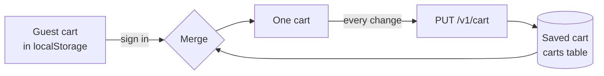
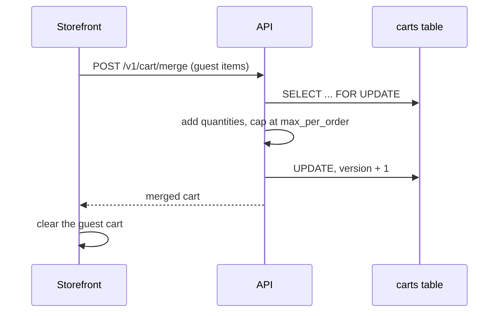

# Spec: Saved carts

- **ID:** SHOP-42
- **Repos:** `api/` (Go service), `web/` (React storefront)
- **Status:** draft, awaiting review

## Objective

Shoppers lose their cart when they switch devices or their session expires. Signed-in shoppers
should find the same cart on any device, and a guest's cart should follow them when they sign in.

### Users

- **Signed-in shopper:** adds items on their phone, checks out later on their laptop.
- **Guest shopper:** fills a cart, then signs in at checkout and expects nothing to disappear.

### What changes

The storefront keeps writing to `localStorage` while signed out. Once signed in, every change goes to
the API, and the API's copy wins on load.

## Acceptance criteria

1. A signed-in shopper who adds an item on one device sees it on another device after a reload.
2. Signing in with a guest cart merges it into the saved cart: quantities of the same SKU add up,
   capped at the SKU's `max_per_order`.
3. A cart untouched for 90 days is deleted by the nightly job.
4. The cart badge never shows a count the API rejected.

## API

| Method | Path | Body | Returns |
| --- | --- | --- | --- |
| `GET` | `/v1/cart` | none | the shopper's cart, `200`, or an empty cart |
| `PUT` | `/v1/cart` | `{ items: [{ sku, qty }] }` | the stored cart, `200`; `409` when `version` is stale |
| `POST` | `/v1/cart/merge` | the guest cart | the merged cart, `200` |

Every write carries the `version` it was based on; a stale version gets `409` and the current cart,
and the storefront re-applies its change on top.

### Sign-in merge

## Data

A `carts` table keyed by `user_id`: `items jsonb`, `version int`, `updated_at timestamptz`. One row
per shopper. No history.

## Testing strategy

- `api/`: table tests for the merge rules (same SKU, cap, unknown SKU dropped), and an integration
  test for the `409` path against a real Postgres in CI.
- `web/`: component tests for the badge, and one Playwright run of the sign-in merge.

## Boundaries

- **Always:** keep the guest cart until the merge call succeeds.
- **Ask first:** any change to the checkout flow itself.
- **Never:** store payment details in the cart.

## Out of scope

Sharing a cart with someone else, wish lists, carts for shoppers who never sign in.

## Open questions

- Should the 90-day expiry warn the shopper by email first?
