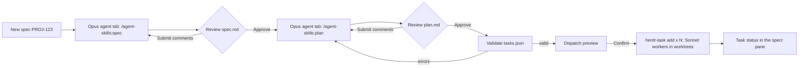

# Spec: specr MVP

A Herdr.app mod for spec-driven development: review an agent's spec and plan like a pull request,
then dispatch the plan's tasks to Shepherdr workers in worktrees.

- **ID:** specr-mvp
- **Inputs:** [docs/ideas/herdr-specr.md](../../docs/ideas/herdr-specr.md) (direction, Not Doing),
  [spike/README.md](../../spike/README.md) (what's proven on this platform)
- **Status:** draft, awaiting review

## Objective

### Problem

Spec-driven development with coding agents has four kinds of friction in Herdr today:

- Reviewing a long `spec.md` or `plan.md` means reading it in an editor and typing feedback from
  memory into chat, one message at a time.
- Turning an approved plan into Shepherdr tasks (models, dependencies, worktrees, repos) is manual.
- Nothing links a spec to its plan, tasks and PRs, especially across repos.
- The right model and skill for each phase (Opus for spec and plan, Sonnet for build) has to be
  remembered every time.

### Users

- **Primary:** a developer running Claude Code agents in Herdr.app with Shepherdr, using
  agent-skills (`/agent-skills:spec`, `:plan`, `:build`, sometimes `:review`). They work in one
  repo, or in a common parent folder when a spec spans several repos. A folder often holds several
  specs, each named by a Jira key.
- **Secondary:** other Herdr.app + Shepherdr users who install specr from herdr.dev/mods and may
  later add an adapter for their own spec framework.

### What specr does

One mod, `specr`, with three jobs. Shepherdr does everything else (worktrees, queueing, workers,
review gates, PRs).

1. **Spec units.** A spec is identified by an ID (a Jira key such as `PROJ-123`, or a slug). Its
   files live in a folder per spec: `specs/PROJ-123/spec.md`, `plan.md`, `tasks.json`. specr's
   working state lives in `.specr/specs/PROJ-123/`.
2. **Review pane.** Rendered markdown with mermaid diagrams. Select text, comment, build up a
   pending review, Submit it as one message to the agent that owns the file. Each round is kept, so
   the next round shows what changed and which comments are now outdated.
3. **Phases and dispatch.** An adapter (one JSON file) says which skill, model and prompt each phase
   uses. specr starts the spec and plan agents. Approving the plan validates `tasks.json` and
   creates the Shepherdr tasks with `herdr-task add`.



### User stories and acceptance criteria

**S1. Start a spec.** As the developer, I start a spec from the palette so that an Opus agent
drafts it into the right place.

- "specr: New spec" opens a dialog: ID (required, `[A-Za-z][A-Za-z0-9-]*`), what to build (a
  brief, required), adapter (default `agent-skills`). Models are shown and can be changed.
- The folder is the focused terminal's working directory. A header button changes it
  (`pickFolder`).
- An ID that already exists in the folder is refused, with a link to open it.
- On Start, specr writes `.specr/specs/<ID>/state.json`, opens an agent tab named `<ID> spec`
  running the adapter's argv (for example `claude --model opus --effort high`), and sends the spec
  phase prompt as its first message. The prompt tells the agent the exact path to write.
- The specr pane opens beside it on that spec, in "Spec · drafting".

**S2. Adopt an existing spec.** As the developer, I register a spec I already have so I can review
and dispatch it with specr.

- "specr: Adopt spec" picks a markdown file (`pickFiles`), optionally a plan and a `tasks.json`,
  and asks for an ID (prefilled from the file name, e.g. `PROJ-9.md` → `PROJ-9`).
- Files stay where they are; `state.json` records their paths.
- The spec starts in the phase its files imply: spec only → "Spec · review"; spec and plan →
  "Plan · review".
- An adopted file has no owner agent; Submit starts one (see S4).

**S3. Review with inline comments.** As the reviewer, I comment on exactly the passage I mean.

- The pane renders the phase document: headings, lists, tables, code, links, inline code.
- Mermaid fences render as diagrams in the current theme (see S8).
- Selecting text shows a comment box with the source lines (`Lines 42-44`). Enter adds the comment
  to the pending review. The selection stays highlighted while typing.
- Pending comments are highlighted in the document and listed in the side panel, in document
  order. Each can be edited or removed. Clicking one scrolls to its section.
- Line numbers are 1-based source lines of the file on disk and match `sed -n '<a>,<b>p'`.
- A selection with no source range (the renderer gives none) shows "Can't comment on this
  selection" and adds nothing.

**S4. Submit a review.** As the reviewer, I send all my comments at once.

- Submit is enabled when there is at least one pending comment.
- The message (format below) goes to the owner agent's terminal with `hc send`.
- If the owner's terminal no longer exists, specr opens a new agent tab for that phase (same
  adapter, model and effort) whose first message is the review, preceded by one line naming the
  file to edit. That tab becomes the owner.
- At Submit, specr saves the file as reviewed and the comments to
  `.specr/specs/<ID>/rounds/<n>/`. The round number goes up by one.
- Nothing is sent anywhere except on Submit.

**S5. See what changed since the last round.** As the reviewer, I only re-read what changed.

- When the file differs from the last round's copy, sections (split at headings) are marked
  `new` or `changed` in the margin, and removed sections are listed at the top.
- A "Changed only" toggle hides unchanged sections.
- Each comment from the last round is looked up by its quoted text in the current file:
  - found once: shown as anchored, highlighted in a muted color, read-only;
  - found more than once: anchored to the occurrence nearest its old offset, marked "moved?";
  - not found: listed as outdated with what it said. No comment is dropped silently.

**S6. Approve and move on.** As the reviewer, I approve a document to start the next phase.

- Approve is disabled while any comment is pending, with the reason shown.
- Approving the spec sets "Plan · drafting" and opens an agent tab `<ID> plan` with the plan
  phase prompt. The prompt names specr as the plan's task list target (the planning skill's
  "external tracker" rule, see Framework notes): the agent writes `plan.md` at its path, starting
  with `Source spec: <spec path>`; records every task and checkpoint in `tasks.json` (schema
  below) instead of `tasks/todo.md`; and keeps the plan's Task List as an ordered index of item
  IDs (`t1`, `t2`, `c1`).
- Approving the plan runs S7.

**S7. Dispatch.** As the developer, approving the plan creates the Shepherdr tasks.

- specr validates `tasks.json` (rules below). On any error it shows every error and dispatches
  nothing; "Send to plan agent" sends the errors as a review.
- A valid file shows a dispatch preview: one row per task and checkpoint with its title, repo
  folder, dependencies, model, and the exact `herdr-task add` argv. A "Review each task with
  /agent-skills:review" toggle (default off) adds the adapter's finish notes.
- Confirm runs `herdr-task add --json` once per item, in dependency order, and records each
  returned `ref` (e.g. `API-14`) in `state.json`. Titles are `<ID> · <title>`. A new task is
  `todo` and doesn't run, so specr then runs `herdr-task start <ref>` for each item: items whose
  dependencies aren't done become `queued` and start by themselves.
- After dispatch, any item whose returned `mode` is `here` (the person turned worktrees off for
  that repo, which overrides `--worktree`) is flagged in the summary.
- Each checkpoint becomes a task that depends on the tasks it follows; tasks after it depend on
  it. Its prompt runs the checkpoint's checks and changes nothing.
- If a call fails, dispatch stops, shows the error, and keeps the refs created so far. Running
  dispatch again creates only the missing items and starts any that were created but not
  started.
- `--after` only ever gets refs that `add` returned. (Shepherdr treats an unknown ref in another
  folder as "removed", which blocks nothing, so a typo would start a task too early.)

**S8. Diagrams.** As the reviewer, I see diagrams, not mermaid source.

- Each mermaid fence is rendered to PNG with mermaid-cli (`mmdc`), theme `dark` or `default`
  to match Herdr, transparent background, scale 2. The picture is cached by
  `hash(source)-theme` under the mod's `.cache/`.
- While rendering, the fence's source shows with a spinner. If `mmdc` is missing or fails, the
  source stays with a one-line note; a missing `mmdc` shows install instructions once.
- Switching Herdr's theme re-renders the diagrams in the other theme.
- A diagram wider than the pane is drawn to fit; clicking it opens it at natural size in a
  scrollable window.

**S9. Build status.** As the developer, I see how a dispatched spec is going.

- In "Build", the pane lists the spec's tasks with their Shepherdr state (queued, working, ready,
  done) and PR link when there is one, grouped by repo, with a count (`4/9 done`).
- Clicking a task opens it in Shepherdr's Tasks tab.

**S10. Several specs in a folder.** As the developer, I switch between specs.

- With no spec selected, the pane lists the folder's specs (from `.specr/specs/*/state.json`):
  ID, title (the document's first heading), phase, pending comments, task count.

### The review message

```text
Review of specs/PROJ-123/spec.md, round 2: 3 comments.

1. Lines 42-44
   > The person opens the pane from the spec's card or the palette.
   Which card? There's no spec card in the MVP.

2. Line 118
   > Outdated
   Say what happens to an outdated comment on Submit.

Please address each comment by number, edit the file in place, and say what changed for each.
```

Quotes are the source markdown, at most four lines each. The path is relative to the spec's
folder.

## Data

### Adapter (`mods/specr/adapters/<id>.json`, version 1)

Framework-specific: which commands and models each phase uses. specr's own instructions (where
to write, the `tasks.json` schema, "this task only") are inserted through `{specr.*}` blocks, so
adapters never repeat them.

```jsonc
{
  "adapter": 1,
  "id": "agent-skills",
  "name": "agent-skills (Addy Osmani)",
  "paths": { "spec": "specs/{id}/spec.md", "plan": "specs/{id}/plan.md", "tasks": "specs/{id}/tasks.json" },
  "agent": { "argv": ["claude", "--model", "{model}", "--effort", "{effort}"] },
  "phases": {
    "spec":  { "model": "opus", "effort": "high", "prompt": "/agent-skills:spec {brief}\n\n{specr.spec}" },
    "plan":  { "model": "opus", "effort": "high", "prompt": "/agent-skills:plan\n\n{specr.plan}" },
    "build": { "agent": "claude", "model": "sonnet", "effort": "medium",
               "prompt": "Use the agent-skills:incremental-implementation and agent-skills:test-driven-development skills (what /agent-skills:build runs).\n\n{specr.task}",
               "review": { "finishNotes": "Before running herdr-task ready, run /agent-skills:review on your changes and fix any blockers." } }
  }
}
```

A folder may override paths and models in `.specr/config.json`; a spec may override models in
its `state.json`. Precedence: spec, folder, adapter.

### Framework notes: agent-skills

Checked against upstream agent-skills 0.6.18 (2026-11-23). specr steers each command through an
extension point the skills already define, not by fighting their defaults:

| Command | Its default | specr's prompt |
| --- | --- | --- |
| `/agent-skills:spec` | Saves `SPEC.md` at the root; if one exists, writes a delta `SPEC-<slug>.md` | Names specr as the project's spec system (the skill's "External spec tools" rule) and gives the path. A delta spec is fine, written at that path |
| `/agent-skills:plan` | Writes `tasks/plan.md` and `tasks/todo.md`; stops if they hold another plan's unchecked tasks | Names specr's `tasks.json` as the task list target (the "external tracker" rule): no `todo.md`, the plan at the spec folder's path, a `Source spec:` line |
| `/agent-skills:build` | Picks the next pending task and marks it complete | Names one task; forbids marking anything complete (parallel workers ticking the same checklist would conflict on merge) |
| `/agent-skills:build` | Its argument `auto` or `all` builds the whole plan | The text after the command never starts with `auto` or `all` |
| `/agent-skills:build auto` | Accepts a spec only at `SPEC.md`, `SPEC-*.md`, `docs/SPEC.md` or `spec/*` | Not used by specr |
| `/agent-skills:build` via Shepherdr | Shepherdr wraps the prompt in its brief ("Your task, HS-1: …"), so a leading slash command is never run as one; the command is also not model-invocable | The build prompt names the skills it runs (`incremental-implementation`, `test-driven-development`) |

Installs older than the external-tracker rule (the one here is commit `f17c6e8`, May 2026) get the
same prompts; there they are plain instructions rather than a rule the skill already knows.

### Spec state (`.specr/specs/<ID>/state.json`, version 1)

```jsonc
{
  "state": 1,
  "id": "PROJ-123",
  "adapter": "agent-skills",
  "brief": "…",
  "paths": { "spec": "specs/PROJ-123/spec.md", "plan": "specs/PROJ-123/plan.md", "tasks": "specs/PROJ-123/tasks.json" },
  "models": { "spec": "opus", "plan": "opus", "build": "sonnet" },
  "phase": "spec",                // spec | plan | build | done
  "status": "review",             // drafting | review | approved
  "round": 2,                     // next round to submit, per phase document
  "owners": { "spec": { "terminal": "t7", "tab": "tb…", "at": 1795641850161 } },
  "pending": [ { "start": 2411, "end": 2476, "lines": [42, 44], "quote": "…", "body": "…" } ],
  "dispatch": { "review": false, "created": { "t1": "API-14", "c1": "API-15" } }
}
```

Pending comments live in `state.json` so they survive a reload or a restart.

### Plan tasks (`specs/<ID>/tasks.json`, version 1), written by the plan agent

```jsonc
{
  "tasks": 1,
  "spec": "PROJ-123",
  "items": [
    { "id": "t1", "kind": "task", "title": "OAuth callback endpoint", "repo": "api", "section": "Task 1: OAuth callback endpoint", "deps": [] },
    { "id": "t2", "kind": "task", "title": "Login button", "repo": "web", "section": "Task 2: Login button", "deps": ["t1"] },
    { "id": "c1", "kind": "checkpoint", "title": "Checkpoint: Foundation", "repo": "api", "deps": ["t1", "t2"],
      "checks": ["All tests pass", "Login works end to end"] }
  ]
}
```

Validation, all errors reported together:

- `tasks` is 1; `spec` equals the spec's ID; `items` is non-empty.
- IDs are unique, match `[a-z][a-z0-9-]*`; every dep names an item; the graph has no cycle.
- `repo` is a path relative to the spec's folder (`"."` for the folder itself) and resolves to a
  git repository.
- A task's `section` is the text of a heading in `plan.md` (specr extracts that section's text
  for the worker's prompt and does not interpret it).
- A checkpoint has at least one check and at least one dep.
- `plan.md` starts with a `Source spec:` line naming the spec's path. A different path is an
  error (the plan was made from another spec); a missing line is a warning, since adopted plans
  may predate it.

### Dispatch command (one per item, argv array, never a shell string)

```text
herdr-task add "<ID> · <title>" --json
  --folder <abs repo> --worktree
  --agent <agent> --model <build model> --effort <build effort>
  --prompt-file .specr/specs/<ID>/prompts/<item id>.md
  [--after <Shepherdr IDs of deps, comma-separated>]
  [--finish-notes "<adapter review finishNotes>"]      # only with the review toggle on
herdr-task start <ref> --folder <abs repo>             # after all adds succeed; queued until deps are done
```

The prompt file holds the adapter's build prompt with `{specr.task}` filled in: the spec and plan
paths, the item's plan section, and "build only this task; don't mark it or anything else
complete in `plan.md`, `tasks/todo.md` or any checklist, Shepherdr tracks status; when it's
committed, run `herdr-task ready`". The text after the slash command never starts with `auto`
or `all`. A checkpoint's prompt lists its checks instead.

## Tech Stack

- **Mod:** JavaScript (ES modules) on Herdr.app's runtime: `gpui-kit`, `gpui-base`, `herdr`,
  `fs/promises`. No build step and no npm packages inside the mod.
- **Host:** Herdr.app ≥ 0.1.18, Shepherdr ≥ 3.1.3 (`herdr-task`), herdr-core (`hc`), git.
  Tested on macOS; Linux expected.
- **Phase agents:** Claude Code (`claude`), with `--model` and `--effort`.
- **Framework (shipped adapter):** agent-skills, tested against 0.6.18; older installs work with
  weaker guarantees (see Framework notes).
- **Diagrams (optional):** `@mermaid-js/mermaid-cli` 12.2.0 with an existing Chrome or Chromium
  (`PUPPETEER_SKIP_DOWNLOAD=1`, `executablePath` in a puppeteer config).
- **Development:** Node ≥ 22 for tests (`node:test`, no dependencies).

## Commands

```sh
npm test                      # node --test test/        (core modules, fixtures)
npm run check                 # herdr-app check ~/.config/herdr-app/mods/specr
npm run link                  # sh scripts/link.sh: link mods/specr into ~/.config/herdr-app/mods/specr
npm run syntax                # node --check on every mods/specr/**/*.js
herdr-app do specr.<command>  # drive a shown copy from a shell (dev commands: top, next-comment, shot-ready)
herdr-app shot out/specr.png  # screenshot the window for visual checks
```

## Project Structure

```text
mods/specr/                → the mod; copied as-is into ~/.config/herdr-app/mods/specr
  mod.json                 → place none, focusable, palette entries
  main.js                  → the View: routes between spec list, review, dispatch, build status
  ui/                      → view pieces: header, document, side panel, dialogs, dispatch preview
  core/                    → pure logic, no herdr or gpui imports, tested with Node
    pieces.js              → split markdown at headings and mermaid fences
    anchors.js             → offsets to lines, re-anchoring by quote
    rounds.js              → section changes between rounds, outdated comments
    adapters.js            → load and validate adapters, resolve paths, models and prompts
    state.js               → spec state and phase transitions
    tasks.js               → tasks.json validation, dependency order, dispatch argv
    review.js              → the review message
  io/                      → effects: files, folder watching, exec, hc, mermaid rendering
  adapters/agent-skills.json
  icons/                   → svg icons
test/                      → node:test files
  fixtures/                → specs, plans, tasks.json (valid and broken), spec-kit and Kiro adapters
scripts/                   → link.sh, syntax check
specs/specr-mvp/spec.md    → this spec
docs/ideas/                → the idea one-pager
spike/                     → the validated spike, reference only
RECIPE.md, preview.png     → for herdr.dev/mods (written at the end)
package.json               → dev scripts only
```

## Code Style

```js
// core/anchors.js — pure: strings and numbers in, plain objects out.
// Offsets are UTF-16 code units, which is what TextView reports and what JS strings index by.
export function anchor(doc, starts, piece, range) {
  const start = piece.start + range.start;
  const end = piece.start + range.end;
  return { start, end, lines: [lineOf(starts, start), lineOf(starts, Math.max(start, end - 1))], quote: doc.slice(start, end) };
}

// ui/document.js — describes elements only. Work starts in init, timers or commands, never here.
export function piece(view, p, t) {
  let tv = TextView.markdown(`md-${p.key}`, p.text).selectable(true)
    .on_selection_change((s, cx) => view.onSelect(p, s, cx));
  for (const r of localRanges(p, view.pending)) tv = tv.highlight_range(r.start, r.end, alpha(t.working, 0.3));
  return div().w_full().min_w(0).text_size(14).text_color(t.foreground).child(tv);
}
```

- `core/` modules are pure and synchronous; anything touching the host lives in `io/`.
- **No side effects in `render()`:** a `cx.notify()` during render throws and kills the task
  silently (spike finding). Start async work from `init`, timers, events or commands.
- Never keep a `cx`; every callback gets its own.
- Colors from `theme()` only; text 12–15 px; works from 320 px wide.
- `exec` takes argv arrays. No `sh -c`, no string-built commands.
- Named exports, small functions, `camelCase` for functions, `kebab-case` for files and IDs.
- Comments say why, not what. No emojis in UI text.

## Testing Strategy

- **Unit (`node:test`), required for every `core/` module:**
  - `pieces`, `anchors`: the spike's fixture plus cases for tables, list items, astral
    characters, text after diagrams; expected lines checked against an independent line count.
  - `rounds`: changed, new and removed sections; comments anchored, moved and outdated.
  - `tasks`: every validation rule with a broken fixture each; dependency order; cycle
    detection; exact argv for tasks, checkpoints, `--after`, the review toggle.
  - `adapters`: the shipped adapter; precedence of spec, folder and adapter values; prompt filling.
  - `review`: the message format above, byte for byte.
  - **Adapter contract:** spec-kit and Kiro adapters as fixtures must load and validate without new
    fields.
- **Check:** `npm run check` after every change to the mod. It must pass in light and dark themes.
- **In the window:** after each UI task, drive a shown copy with `herdr-app do specr.<command>`
  and look at `herdr-app shot`.
- **End to end, before release (manual checklist in `test/e2e.md`):** in a scratch folder with two
  scratch repos, run S1 → S4 (one round) → S5 → S6 → S7 with a checkpoint → S9, and S2 with an
  existing file. Confirm the tasks with `herdr-task list --json`.

## Boundaries

- **Always:**
  - Keep `core/` free of host calls, with tests for each module.
  - Pass `npm test` and `npm run check` before saying a task is done.
  - Validate `tasks.json` fully and show the exact commands before any `herdr-task add`.
  - Write only to the spec's folder files specr owns (`.specr/…`, prompt files) and the mod's
    `.cache/`.
  - Leave the agent's documents untouched: specr never edits `spec.md`, `plan.md` or
    `tasks.json`.
- **Ask first:**
  - Adding any dependency, including dev dependencies.
  - Changing the version or shape of the adapter, `state.json` or `tasks.json`.
  - Calling any `herdr-task` subcommand other than `add`, `start`, `list` and `show`.
  - Starting an agent other than for S1, S4 (owner gone) and S6.
- **Never:**
  - Write Shepherdr's files (`~/.herdr/tasks/*`) directly.
  - Send anything to an agent except on Submit, approve, or "Send to plan agent".
  - Dispatch without a valid `tasks.json` and an explicit Confirm.
  - Interpret plan markdown beyond extracting a section by its heading.
  - Run work from `render()`.

## Success Criteria

1. S1: "New spec" with ID `DEMO-1` writes `specs/DEMO-1/spec.md`, not `SPEC.md`, in 3 of 3 runs.
2. S3: comments on a paragraph, a table cell, two list items and text after a diagram report
   lines that match `sed -n`.
3. S4: Submit puts exactly one message in the owner's terminal (checked with `hc read`), and saves
   round 1. With the owner closed, Submit opens a new `<ID> spec` tab that receives the review.
4. S5: after the agent edits the file, round 2 marks the edited sections, and every round-1
   comment is anchored, "moved?" or outdated.
5. S6: Approve is disabled with a pending comment. Approving the spec writes `plan.md` and
   `tasks.json` at their spec-folder paths, and no `tasks/todo.md`.
6. S7: a `tasks.json` with a cycle and an unknown repo shows both errors and creates no tasks. A
   valid two-repo file with one checkpoint creates every item with the right `--folder`, `--after`
   and `--model`, titled `DEMO-1 · …`. Re-running after a forced failure creates only the
   missing items.
7. S8: both fixture diagrams render in dark and light; with `mmdc` off `PATH` they show as source
   with the install note.
8. S2: adopting `PROJ-9.md` leaves the file in place and reviews it like any other spec.
9. `npm test` and `npm run check` pass.

## Out of Scope (MVP)

From the idea doc's Not Doing list: a separate Specs board tab, a second shipped adapter,
parsing plan markdown, finding specs by scanning files, a Jira integration, phone review, a
traceability matrix, worker-proposed spec amendments, editing or re-planning dispatched tasks,
bundling a mermaid renderer, tracking worker state beyond reading Shepherdr, and multiple
machines. Also: threads and replies on comments, suggested-change blocks, comments that span two
sections or a diagram.

## Assumptions (to confirm during the plan)

- Naming specr as the spec system and the task list target makes the agent write to specr's
  paths and skip `tasks/todo.md`. On agent-skills 0.6.x this uses the skills' own rules; on older
  installs it relies on the prompt alone. Check both. Fallback: move files into place when the
  phase ends, and ignore a stray `todo.md`.
- Opus writes a valid `tasks.json` from the prompt and schema. "Send to plan agent" covers
  misses.
- A symlinked `~/.config/herdr-app/mods/specr` loads and hot-reloads like a copied folder (for
  `npm run link`).
- `hc send` delivers a multi-line review intact to Claude Code.

### Confirmed during planning (from Shepherdr 3.1.3's `herdr-task` source)

- `add --json` prints the task with `ref` (`API-14`), `prefix`, `mode` and `state: "todo"`; it
  never starts the task.
- `--after` accepts full refs for the same folder and for other folders; an unknown ref in another
  folder blocks nothing.
- `start` on a task with unfinished dependencies queues it; queued tasks start by themselves.

## Open Questions

1. Where do machine settings live (the `mmdc` path, the puppeteer config)? A file the person edits,
   or a small settings view saving to the mod's `localStorage`?
2. Should the build status (S9) poll `herdr-task list --json` per repo, or watch Shepherdr's task
   files for changes and re-read through `herdr-task`?
3. Is `specr` free as a name on herdr.dev/mods?
4. The skills also read the project's agent rules (`AGENTS.md`, `CLAUDE.md`) to find the spec
   system and task tracker. Should specr offer to add a short block there, so `/agent-skills:plan`
   run by hand outside specr also writes `tasks.json`? It edits the person's files, so it would be
   opt-in.
