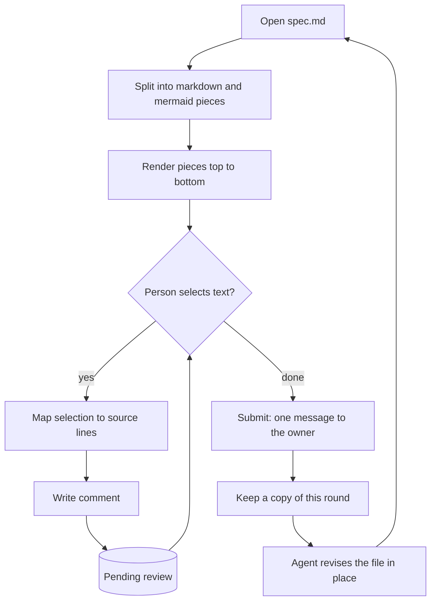
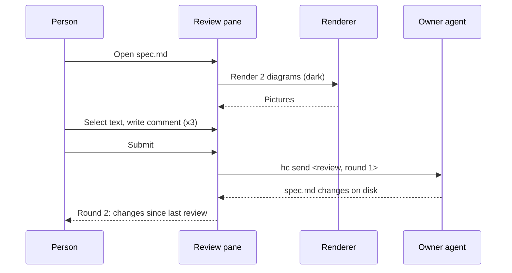

# PROJ-123: Review pane for agent-written specs

## Objective

Give the person a way to review a spec or plan the way they review a pull request: read it
rendered, comment on exactly the passage they mean, collect those comments as a pending review,
and send them back to the agent in one go. The agent revises the file in place, and the next round
starts on what changed since the last review instead of the whole document again.

Today the person reads `SPEC.md` in an editor or a terminal pager, then types feedback into the
agent's chat from memory: "the second bullet under Boundaries is wrong", "that diagram is missing
the retry path". Two things go wrong:

- the agent has to guess which passage was meant, and sometimes edits the wrong one;
- a long review gets sent as a trickle of messages, so the agent starts revising after the first
  comment and has to redo work when the third one arrives.

### Who this is for

- **Primary:** a developer running coding agents in Herdr who writes a spec before building, and
  reviews it themselves before any code is written.
- **Secondary:** a reviewer who is handed a spec folder by a colleague and wants to leave comments
  without editing the file.

### What success looks like

1. A review of a 300-line spec with eight comments takes one Submit, not eight messages.
2. Every comment the agent receives names its source lines and quotes the text it is about.
3. On round two, the person sees only what changed, and old comments are either still anchored or
   clearly marked outdated.
4. Diagrams written as mermaid fences render as diagrams, in light and dark themes.

## Scope

### In scope

- Rendering one markdown file from a spec folder, with headings, lists, tables, code and links.
- Mermaid fences rendered as images, cached by content and theme.
- Selecting text in the rendered view and attaching a comment to that selection.
- A pending review: comments listed beside the document, editable and removable before Submit.
- Submit: one message to the agent that owns the file, with every comment and its anchor.
- Keeping a copy of the file at each Submit, so the next round can show what changed.

### Out of scope

- Editing the spec from the review pane. The agent owns the file; the person owns the comments.
- Suggested changes (GitHub's suggestion blocks). Useful, but a second feature.
- Threads and replies. A comment is one message; the agent answers in its own chat.
- Reviewing on the phone. The custom panel only runs in the window.

## Terms

| Term | Meaning |
| --- | --- |
| Spec folder | `specs/<ID>/`, holding `spec.md`, `plan.md` and `tasks.json` |
| Round | One Submit. Round 1 is the first review of a file; each Submit starts the next |
| Anchor | A source range `[start, end)` in UTF-16 offsets, plus the quoted text |
| Outdated | A comment whose quoted text can no longer be found in the current version |
| Owner | The agent that wrote the file and receives the review |

## How a review flows

The person opens the pane from the spec's card or the palette. The pane reads the file, splits it
into markdown pieces and diagram pieces, and renders them top to bottom. Selecting text in any
markdown piece offers a comment box. Comments pile up in the side panel until Submit.



### Mapping a selection to source lines

The rendered text is not the source. A bold word is drawn without its asterisks, a link without its
URL, and a list item without its dash. The renderer reports a settled selection as UTF-16 offsets
into the markdown it was given, so the pane can recover the exact source with
`markdown.slice(start, end)`.

Because the document is split into pieces, each piece reports offsets relative to itself. The pane
keeps each piece's start offset in the whole file and adds it:

```js
const global = { start: piece.start + local.start, end: piece.start + local.end };
const lines = [lineOf(global.start), lineOf(global.end - 1)];
```

`lineOf` is a binary search over the offsets where each line starts. Line numbers are 1-based, as
in an editor.

Edge cases the mapping must survive:

- A selection inside a table cell, where the rendered text has no pipes.
- A selection across two list items, which spans a newline and a dash.
- Text with characters outside the Basic Multilingual Plane, such as the math italic 𝑓, which
  takes two UTF-16 code units; a café → bistro arrow, which takes one each.
- A selection that starts in one piece and ends in another. The renderer can't report it: each
  piece is its own view. The pane should say so rather than guess.

### What the agent receives

One message, sent with `hc send` to the owner's terminal:

```text
Review of specs/PROJ-123/spec.md, round 1: 3 comments.

1. Lines 42-44
   > The person opens the pane from the spec's card or the palette.
   Which card? There's no spec card in the MVP.

2. Lines 118-118
   > Outdated
   Say what happens to an outdated comment on Submit: dropped or resent?

Please address each comment by number, edit the file in place, and say what changed for each.
```

## Rounds and what changed

Each Submit stores the file as it was, beside the review, in `.specd/specs/<ID>/rounds/<n>/`.
When the file changes after a Submit, the pane opens on the changes since the last round:

- added and changed passages are marked in the margin;
- every comment from the last round is looked up again by its quoted text;
- a comment whose text is found keeps its place, moved to the new offsets;
- a comment whose text is gone is listed as outdated, with what it said.

Matching by quoted text is deliberately simple. It fails when the agent rewords the passage the
comment was about, which is usually what the comment asked for. Marking those outdated is the
correct outcome, not a bug.

### Storage

| File | Written | Holds |
| --- | --- | --- |
| `.specd/specs/<ID>/state.json` | on every change | phase, file paths, current round |
| `.specd/specs/<ID>/rounds/<n>/review.json` | at Submit | the comments and their anchors |
| `.specd/specs/<ID>/rounds/<n>/<file>` | at Submit | the file as it was reviewed |

Nothing in `.specd/` is needed to build the product, so the folder is suggested for `.gitignore`.

## Diagrams

Mermaid fences are rendered by an external tool, because the window cannot run a browser engine.
The pane runs the tool once per diagram and theme and caches the picture by a hash of the source.

- Light theme: the tool's default theme, transparent background.
- Dark theme: the tool's dark theme, transparent background.
- If the tool is missing or fails, the fence is shown as source with a one-line note, never as a
  blank space.

Rendering a diagram takes about a second once the browser is warm, and several seconds when it
starts cold. The pane shows the source until the picture is ready.



## Commands

| Command | What it does |
| --- | --- |
| `specd review <ID> [spec\|plan]` | Open the review pane on a spec's file |
| `specd rounds <ID>` | List the rounds of a spec and their comment counts |
| `specd outdated <ID>` | Print the comments that no longer anchor |

## Project structure

```text
mods/specd/
  main.js        the review pane
  segments.js    split markdown into text and diagram pieces
  anchors.js     offsets, line numbers, re-anchoring by quote
  render.js      the diagram tool, its cache and its fallbacks
  review.js      building the message and storing rounds
```

## Code style

- Plain modern JavaScript, no build step: the window loads the files as they are.
- Colors from the theme only. Text between 12 and 15 px.
- Pure functions for offsets and anchors, so they can be tested without a window.
- No timers for animation; the diagram spinner uses the native frames helper.

## Testing strategy

- **Unit:** `segments.js` and `anchors.js` against fixture files, including this one. Offsets are
  checked by slicing the source and comparing with the expected text.
- **Check:** `herdr-app check` on the mod after every change, in light and dark.
- **Manual, each release:**
  - select across a table row and confirm the reported lines;
  - comment on text after the 𝑓 and confirm the quote is exact;
  - switch the theme and confirm the diagrams re-render;
  - delete the diagram tool and confirm the fallback.

## Boundaries

- **Always:** keep the agent's file untouched; send nothing until the person presses Submit; show
  the source of anything that failed to render.
- **Ask first:** before storing anything outside the spec folder and `.specd/`.
- **Never:** edit the spec on the person's behalf; send comments one at a time; drop a comment
  silently when its anchor is lost.

## Open questions

1. When the owner agent has exited, should Submit resume its session or start a new one with the
   file and the review?
2. Should a comment be allowed on a diagram as a whole, anchored to its fence?
3. Is "changes since last round" a diff view, or the normal view with marks in the margin?
4. How should a selection that crosses from one piece into the next be handled: refused, or split
   into two comments?

## Appendix: sample review data

```json
{
  "round": 1,
  "file": "specs/PROJ-123/spec.md",
  "comments": [
    { "start": 2411, "end": 2476, "lines": [42, 44], "quote": "The person opens the pane", "body": "Which card?" }
  ]
}
```

## Appendix: why not a web view

The window draws natively and has no browser engine, so the usual approach of rendering mermaid in
the page is not available. An external renderer keeps the pane native and fast, at the cost of a
dependency and a short delay the first time a diagram is drawn. The alternative, a picture taken by
the agent and committed beside the spec, was rejected: pictures go stale when the source changes,
and the person would review the picture rather than the source.

## Appendix: decisions log

| Date | Decision | Why |
| --- | --- | --- |
| 2026-11-25 | Folder per spec | Several specs per folder, named by ticket |
| 2026-11-25 | Anchor by quoted text | Simple, and outdated is the honest outcome |
| 2026-11-25 | External diagram renderer | No web view in the window |
| 2026-11-25 | One message per review | Agents act on the first message they get |

## Appendix: glossary of review states

- **Pending:** written, not yet sent. Can be edited or removed.
- **Sent:** part of a submitted round. Read-only.
- **Anchored:** its quote was found in the current version.
- **Outdated:** its quote was not found; kept in the round's record.
- **Resolved:** the person marked it done after reading the agent's answer.

End of spec.
